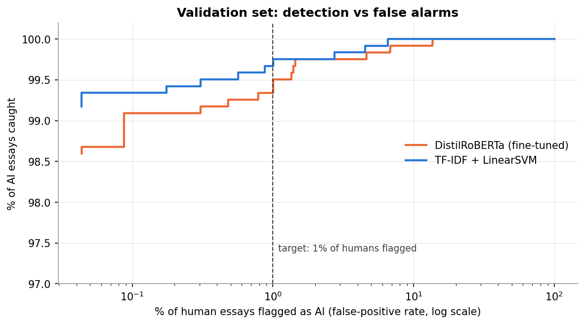
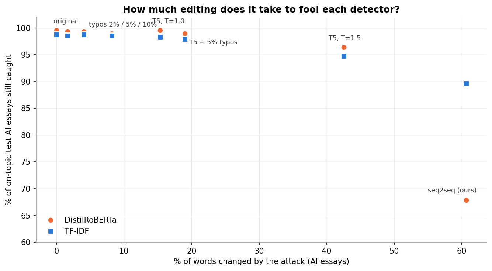
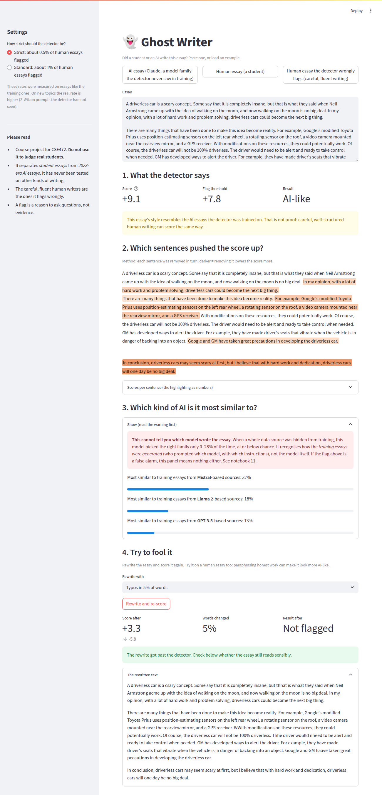

# Ghost Writer: Detecting AI-Generated Student Essays


Given an essay, decide whether a student or a large language model wrote it, and measure honestly how far that decision can be trusted.

Course project for **CSE472: Deep Learning for NLP**, built one syllabus unit at a time: classical baselines, word embeddings, recurrent networks, a fine-tuned transformer, zero-shot detection with GPT-2, a seq2seq paraphraser used to attack the detector, and explanations of its decisions. There is an [interactive demo](#demo) and a [model card](MODEL_CARD.md).

## Headline result

A fine-tuned **DistilRoBERTa** detector (final system: three seeds combined on a probability scale), evaluated on essays it could not have memorised. AUC is about 1.0 everywhere, so it says little; the numbers below are fixed-threshold rates with 95% intervals, from a check of two unseen prompts and three unseen AI generators that was defined and committed before it was run ([20](Notebooks/20_final_heldout_check.ipynb)).

| Evaluation (on-topic essays) | Final system, "1%" operating point |
|---|---|
| Human essays wrongly flagged on two unseen prompts, pooled | **0.70%** [0.48, 0.95]; 0.11% on one prompt and **1.60%** [1.11, 2.31] on the other |
| The same essays with the earlier single-model "1%" threshold | 3.85% |
| AI essays on those prompts caught | 99.70% |
| AI essays from three AI models never seen in training caught | **94.92%** [93.95, 95.80] (98.97% flagged or in the "above usual" zone); 99.8% with the earlier threshold |

The stricter threshold cuts false flags on new topics about fivefold and costs about five points of detection on AI models it has never seen. A threshold chosen on familiar data does not keep its false-positive rate on new topics; the new one is set by a rule judged on topics it was not set on ([18b](Notebooks/18b_threshold_original_recipe.ipynb)). Caveats: the two prompts are not pristine (the single model had been scored on them), and one of them is still above 1%.

## Why this project was rebuilt

The first version of this project (kept in [`Archive/`](Archive/)) reported **100% accuracy**. That number was not real: 141 AI essays from a single self-generated batch against 141 human essays, a 57-essay test set, and a TF-IDF model that learned the style of that one batch.

The rebuild replaces the data with **DAIGT-V2** (44,868 essays, 15 AI generators), adds deep learning, and treats every high score as something to be checked:

- **Near-duplicates are grouped** (MinHash + LSH) so no cluster of near-identical essays is split across train and test.
- **Two robustness slices are held out completely:** two essay prompts, and two AI model families.
- **Shortcuts are hunted and neutralised:** four AI sources started every essay with a space (no human essay did); half of all AI essays turned out to be off-topic for their prompt label, so every model is also scored on **on-topic essays only**; curly quotes and spelling were tested as possible shortcuts.
- **Reference models** (essay length only, prompt only) show what a score is worth before any real model is trained.

Details in the [data card](data/processed/DATA_CARD.md).

## Results

### Human vs AI detection

All on-topic essays. "Unseen generators detected" is at each model's default threshold, except GPT-2, whose threshold is set on validation for a 1% false-positive rate.

| Model | Notebook | Test AUC | Unseen prompts AUC | Unseen generators detected |
|---|---|---|---|---|
| Essay length only (reference) | 06 | 0.674 | 0.700 | 0.1% |
| TF-IDF + Linear SVM | 04 | 1.000 | 0.997 | 88.0% |
| Averaged GloVe + LogReg | 05 | 0.981 | 0.484 | 85.2% |
| Averaged Word2Vec (Skip-gram) + LogReg | 05 | 0.995 | 0.935 | 80.4% |
| BiLSTM | 07 | 0.998 | 0.957 | 87.0% |
| BiGRU | 07 | 1.000 | 0.934 | 95.5% |
| GPT-2 perplexity (zero-shot, no training) | 10 | 0.978 | 0.939 | 17.8% |
| **DistilRoBERTa, fine-tuned** | 08 | **1.000** | **1.000** | **99.9%** |

What the table shows:

- **In-distribution, everything looks perfect.** DAIGT-V2 is effectively "student essay vs 2023-era LLM essay", which even 2,000 TF-IDF examples separate almost perfectly. The informative columns are the unseen ones.
- **Averaged embeddings mostly encode topic.** Averaged GloVe drops to chance on unseen prompts once off-topic AI essays are removed.
- **Perplexity catches predictable models, not AI in general.** GPT-2 finds PaLM (perplexity 5.5) and Mistral (6.5) easy, but Claude (26) and GPT-4 (23.5) are almost as surprising as human essays (29).
- **Pretraining is what transfers.** Only the fine-tuned transformer holds up on both unseen topics and unseen model families.

### Choosing the decision threshold

The default 0.5 threshold over-flags human essays (DistilRoBERTa is over-confident). Thresholds are therefore chosen on validation human essays for a target false-positive rate ([09](Notebooks/09_threshold.ipynb)):

| DistilRoBERTa threshold | Test humans flagged | Unseen-prompt humans flagged | Unseen generators detected |
|---|---|---|---|
| Default (0.5) | 1.36% | 5.61% | 99.9% |
| 1% target | 0.92% | 3.85% | 99.8% |
| 0.5% target | 0.40% | 2.31% | 99.2% |



### What the external review changed

An outside review noted that AUC was saturated and single numbers had no error bars. The model-improvement pass (notebooks 15-21) therefore measures, rather than adds capability:

- error bars on every number, and an audit of every claim (`15`);
- a common probability scale for the scores of different training runs, whose logit thresholds disagree (+4.67 / +5.28 / +7.82 for three seeds) (`15`, `18`);
- a threshold rule judged leave-one-topic-out over 13 topics (`16b`, `18`, `18b`), and a three-seed ensemble (`19`);
- a documented negative result: spelling repair plus typo injection looked good on 7 prompts and failed on all 13 (`17`, `17b`, `17c`);
- a held-out check defined and committed before it was run (`20`), and false-flag rates by student group (`21`, `21b`).

The "above usual" zone sits between flagged and not flagged. Wording: *higher than most student essays, but most essays that score here are written by students (about 7 in 10 at a one-third AI share, about 9 in 10 at 10%).*

### Attacking the detector

Typo injection and two paraphrasers (our seq2seq model trained from scratch, and a pretrained T5) were applied to AI essays ([13](Notebooks/13_attack.ipynb)):

| Attack | Words changed | AI essays still caught |
|---|---|---|
| None | 0% | 99.6% |
| Typos in 10% of words | 8% | 98.9% |
| T5 paraphrase (light) | 15% | 99.6% |
| T5 paraphrase (heavy) | 43% | 96.4% |
| Our seq2seq paraphraser | 61% | 67.9%, but the essay's meaning is destroyed |



Paraphrasing *human* essays with T5 raised their false-positive rate from 0.7% to 2.7%: running honest work through a paraphrasing tool can make it look machine-written. LLM-based "humanisers" were not tested (too large for the 4 GB GPU used here).

### Which model wrote it?

Generator attribution ([11](Notebooks/11_attribution.ipynb)) looks excellent on a random split (macro-F1 **0.976** over 8 model families). It **does not generalise**: when a whole data source is held out, its essays are assigned to the right family only 0–28% of the time, at or below chance. The models recognise *who generated the essays and how they prompted them*, not the model family.

## Demo

```
bash scripts/demo.sh
```

One command: it builds the page if needed, starts one server that serves the page and the API together, loads every model once and opens http://localhost:8000. A five-minute click-by-click path for presenting it is in [docs/viva-demo.md](docs/viva-demo.md).

The web app has three pages:

- **Check an essay:** paste an essay (or a .docx, .pdf or .txt file) or load an example. The score is shown on a ruler against the flag line chosen on validation data (strict or standard), with the false-flag rates measured on student essays, sentence highlights, and a collapsed, clearly-warned "which AI is it most like?" panel.
- **Try to fool it:** rewrite the essay with typos (5% or 10% of words) or a pretrained T5 paraphraser (light or heavy) and score it again. Every attempt, with its seed and words changed, is kept in a list. On a human essay the detector wrongly flags, it shows the other side of the problem: edits that add nothing can flip the answer.
- **Check a class:** score a set of essays at once and see how many cross the flag line, against how many flags you would expect even if every essay were written by a student (a range, not one number). The two built-in demo classes (30 held-out essays each, real authors known) show the result against the true labels.

Every figure on the pages is read from the results files in `results/`; none is typed into the page. Uploaded files are read in memory and never saved; scores stay in the browser tab and are cleared when it closes (checked by tests). The API is explained in [docs/api.md](docs/api.md). The earlier Streamlit demo still works (`streamlit run demo/app.py`) but do not run it at the same time as the web app: the GPU has 4 GB.



- **This is a course project.** It must not be used to make decisions about real students. More in the [model card](MODEL_CARD.md).

## Project structure

```
Notebooks/   01–21, one topic each, run in order (each opens with its goal and ends with key takeaways)
src/         data.py (the one way to load data), evaluate.py (shared scoring),
             detector.py (fine-tuned detector + thresholds), paraphraser.py (attack tools),
             explain.py (sentence highlighting), attribution.py (demo's source-similarity panel),
             compare.py, conformal.py, ensemble.py (probability-scale thresholds and the ensemble), spelling.py, augment.py
api/         FastAPI over src/ (score, explain, attribution, rewrite, batch, demo classes)
frontend/    Vite + React web app (plain JavaScript with JSDoc types); `npm run check` runs lint, types and tests
design/      the design spec and artboards the web app was built to
tests/       49 tests (46 API tests including the privacy tests, 3 browser tests for the highlights); run `pytest`
scripts/     demo.sh (one-command start), warm_up.py, motion_audit.py; lopo_run.sh, phase3_run.sh, phase5_run.sh (resumable GPU runs),
             build_persuade_demographics.py
docs/        api.md, viva-demo.md, frontend plan and decisions
demo/        samples.json (three examples), class_sample/ (the two demo classes), app.py (older Streamlit demo)
data/        processed/: deduplicated essays, splits, on-topic flags, data card (raw data not committed)
results/     metrics for every model, as CSV
images/      plots produced by the notebooks
Archive/     the original, flawed 100%-accuracy version
```

| # | Notebook | Topic |
|---|---|---|
| 01 | `01_eda_baseline` | Dataset exploration |
| 02 | `02_dedup` | Near-duplicate detection (MinHash + LSH) |
| 03 | `03_split` | Leakage-safe split and held-out slices |
| 04 | `04_baseline` | Reference models, TF-IDF + LogReg/SVM, leakage checks |
| 05 | `05_embeddings` | Word2Vec (CBOW vs Skip-gram), GloVe, PCA/t-SNE |
| 06 | `06_topic_check` | Off-topic AI essays and a fair on-topic evaluation |
| 07 | `07_bilstm` | BiLSTM and BiGRU classifiers |
| 08 | `08_bert` | Fine-tuned DistilRoBERTa |
| 09 | `09_threshold` | Thresholds for a target false-positive rate |
| 10 | `10_zero_shot` | GPT-2 perplexity, burstiness, log-rank, DetectGPT-lite |
| 11 | `11_attribution` | Which model family wrote it |
| 12 | `12_paraphraser` | Seq2seq + Bahdanau attention paraphraser, from scratch |
| 13 | `13_attack` | Typo and paraphrase attacks on the detector |
| 14 | `14_explain` | Sentence-level explanations, error analysis, ethics and limitations |
| 15 | `15_uncertainty` | Intervals on every number; claims audit |
| 16 / 16b | `16_long_essays`, `16b_topic_lopo` | Windowed scoring (negative result); leave-one-prompt-out over 13 prompts |
| 17 / 17b / 17c | `17_augment`, `17b_augment_results`, `17c_cowboy_diagnosis` | Spelling/typo augmentation: a negative result and why |
| 18 / 18b | `18_robust_threshold`, `18b_threshold_original_recipe` | Probability scale and threshold rules judged on unseen topics |
| 19 | `19_ensemble_stability` | Three-seed ensemble; verdict stability across seeds and typos |
| 20 | `20_final_heldout_check` | Held-out prompts and generators, scored once |
| 21 / 21b | `21_fairness_persuade`, `21b_fairness_adjusted` | False-flag rates by student group, raw and adjusted for prompt |

## Reproducing

1. `pip install -r requirements.txt`
2. Download the [DAIGT-V2 train dataset](https://www.kaggle.com/datasets/thedrcat/daigt-v2-train-dataset) and save it as `data/raw/train.csv`.
3. Run the notebooks in order from inside `Notebooks/`. Notebooks 01–07 run on CPU. 08 onward need a CUDA GPU (notebooks 16b, 17 and 19 are long: about 15 minutes per fine-tune, 3 h 48 min for the 13 folds of 16b, about 75 minutes for the seed runs of 19) (developed on an RTX 3050 Laptop, 4 GB). Pretrained models (DistilRoBERTa, GPT-2, T5) download from Hugging Face on first use, and trained weights are saved to the git-ignored `models/`.
   For exact versions use `pip install -r requirements-lock.txt` (what the results were produced with). Notebook 21 needs the public PERSUADE 2.0 files (`scripts/build_persuade_demographics.py`; the per-essay mapping is git-ignored, only aggregates are committed).
4. Start the demo with `bash scripts/demo.sh` (needs notebooks 08 and 09 first, for the detector and its thresholds; needs Node for the first build, and `pip install -r requirements-dev.txt` to run the tests).

## Status

Weeks 1–8 of the plan and the model-improvement pass (notebooks 15–21) are done: all the modelling, the explanations, the demo (a web app, merged into `main`) and the model card. The web demo still runs the single seed-42 model; switching it to the final system is planned with the front-end work. Still to come: the written report and slides, then final polish.

## Limitations

- **False-flag rate varies by topic:** 0.4% to 5.8% across 13 unseen topics with the old threshold; one of two held-out prompts is still above 1% (1.60%) with the new one.
- **A flag is not a stable fact about an essay:** only 14-40% of humans flagged by any one seed are flagged by all three (small samples), and essays near the line flip under 5% typos 26-40% of the time.
- **The strict threshold loses detection on unseen AI generators** (94.9%, against 99.8% before).
- **Only two held-out topics, and not pristine.**
- **Groups of students (not a fairness guarantee):** every attribute tested is in the [model card](MODEL_CARD.md#fairness-across-groups-of-students), raw and adjusted for prompt. English learners: 0 of 340 flagged (upper bound 1.12%, about twice the other students' 0.54%; not a test of TOEFL-style writers). Students who are not economically disadvantaged (adjusted -0.53 [-1.01, -0.03] points for disadvantaged students) and girls (boys -0.34 [-0.68, -0.01]) are flagged somewhat more within a topic; Asian/Pacific Islander students have the highest rate (1.91%, 9 flagged essays; adjusted +1.16 [-0.30, +2.99]); the grade-11 gap is prompt mix. About 14 comparisons were made, so some intervals will exclude zero by chance, and no group's estimate rests on more than 23 flagged essays.
- **A training change that looked good was rejected:** spelling repair plus injected typos lowered false flags on 7 prompts but raised them on all 13 (+0.57 points; Cowboy 4.30% to 17.42%). Likely mechanism: injecting typos into AI training essays taught the model that typos signal AI (Cowboy essays with over 2% misspellings: 32 of 409 flagged, 7.8%, against 3 for the original); it would have flagged weak spellers more.

## Author

Jaiveer Singh Minhas
